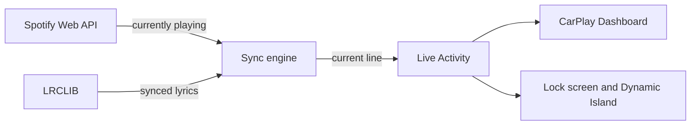

# Lyrics for CarPlay

[](https://developer.apple.com/ios/)
[](https://swift.org)
[](LICENSE)

A free, personal lyrics companion for Spotify. It shows the **current lyric line as a Live Activity**, and iOS 26 puts Live Activities on your **CarPlay Dashboard**. You also get the lyrics on your lock screen and Dynamic Island.

No CarPlay entitlement. No App Store review. No subscription.

<!--
Add screenshots here, for example:


-->

## How it works



1. Polls the Spotify Web API every 5 seconds to get the current track and position
2. Looks up time-synced lyrics from [LRCLIB](https://lrclib.net) (free, open, no API key)
3. Matches the playback position to the right lyric line
4. Updates a Live Activity, which iOS shows on CarPlay for you

## Tech stack

- **SwiftUI** for the app screen
- **ActivityKit and WidgetKit** for the Live Activity
- **Spotify Web API** with OAuth 2.0 **PKCE** login (`ASWebAuthenticationSession`, `CryptoKit`)
- **Keychain** for token storage
- **async/await** for networking and the polling loop
- **LRCLIB** for synced lyrics in LRC format

## Requirements

- A Mac with Xcode 26 or newer (Xcode must support your iPhone's iOS version)
- An iPhone running **iOS 26 or later** (Live Activities show on CarPlay starting in iOS 26)
- A free Apple ID signed in to Xcode
- A Spotify account with **Premium**. Spotify requires Premium for the owner of any Development Mode app. See the [Spotify announcement](https://developer.spotify.com/blog/2026-02-06-update-on-developer-access-and-platform-security).

## Setup

### 1. Register a Spotify app

1. Go to the [Spotify Developer Dashboard](https://developer.spotify.com/dashboard) and log in
2. Create an app and select **Web API**
3. Add this Redirect URI exactly: `lyricscarplay://spotify-callback`
4. Copy the **Client ID**

Development Mode apps are limited to 5 users, which is fine for personal use.

### 2. Create the Xcode project

1. In Xcode: **File > New > Project > iOS > App**
2. Name it `LyricsCarPlay`, interface **SwiftUI**, language **Swift**
3. Delete the files Xcode generated (`ContentView.swift` and `LyricsCarPlayApp.swift`). This repo has its own versions.

### 3. Add the widget extension

1. **File > New > Target > Widget Extension**
2. Name it `LyricsWidget`
3. Check **Include Live Activity** and uncheck any configuration intent option
4. Delete the Swift files Xcode generated inside the `LyricsWidget` folder. This repo has its own.

### 4. Add the source files

Drag the files from this repo into Xcode:

| Folder | Add to target |
|--------|---------------|
| `App/` | `LyricsCarPlay` |
| `Widget/` | `LyricsWidget` |
| `Shared/LyricsActivityAttributes.swift` | **Both** `LyricsCarPlay` and `LyricsWidget` |

For the shared file, select it in Xcode, open the File Inspector, and tick both target boxes. The app and the widget must compile the same file so they agree on the data shape.

### 5. Add your Client ID

```bash
cp Config/Secrets.swift.example App/Secrets.swift
```

Open `App/Secrets.swift` and replace `YOUR_SPOTIFY_CLIENT_ID` with your Client ID. Add the file to the **LyricsCarPlay** target only. `Secrets.swift` is in `.gitignore`, so it will not be pushed to GitHub.

### 6. Configure the app target

In the **LyricsCarPlay** target, open the **Info** tab:

- Add a URL Type with URL Schemes = `lyricscarplay` (this lets the Spotify login return to the app)
- Add the key `NSSupportsLiveActivities` = `YES`

### 7. Run it

1. In **Signing & Capabilities**, choose your Apple ID team for **both** targets
2. Select your iPhone and press **Run**
3. On the iPhone: **Settings > General > VPN & Device Management** and trust your developer certificate
4. Open the app, tap **Connect Spotify**, and log in
5. Play a song, then connect to CarPlay and swipe to the Dashboard

### Optional: reinstall every week

Apps signed with a free Apple ID expire after 7 days. You can run from Xcode again, or export an `.ipa` (**Product > Archive > Distribute App > Development**) and re-sign it each week with [Sideloadly](https://sideloadly.io).

## Project structure

```
.
├── App/
│   ├── LyricsCarPlayApp.swift     # App entry point
│   ├── ContentView.swift          # Main screen: connect button, current track and line
│   ├── SpotifyAuth.swift          # PKCE login, token exchange and refresh
│   ├── SpotifyClient.swift        # Currently-playing request
│   ├── LyricsClient.swift         # LRCLIB request and LRC parser
│   ├── LyricsSyncEngine.swift     # Polling loop, line matching, Live Activity updates
│   └── KeychainHelper.swift       # Keychain save, load and delete
├── Widget/
│   ├── LyricsWidgetBundle.swift   # Widget extension entry point
│   └── LyricsLiveActivity.swift   # Live Activity, lock screen and Dynamic Island UI
├── Shared/
│   └── LyricsActivityAttributes.swift   # Data shared by the app and the widget
└── Config/
    └── Secrets.swift.example      # Template for your Spotify Client ID
```

## Privacy and security

- Login uses **PKCE**, so there is no client secret in the app
- Access and refresh tokens are stored in the **Keychain**, not in `UserDefaults`
- The app only asks for two Spotify scopes: `user-read-currently-playing` and `user-read-playback-state`
- No analytics and no tracking
- Lyrics are fetched while you listen and are not saved

## Known limitations

- **Sync is not frame-perfect.** The app polls every 5 seconds and estimates the position in between. Lines land close to on time, not karaoke-precise.
- **Background updates depend on iOS.** It works well while the app is open or was used recently. On a long drive with the app deep in the background, iOS may slow down or pause updates. A small push server that updates the Live Activity remotely would fix this.
- **Not every song has synced lyrics.** LRCLIB is community-sourced. Popular songs are usually covered. New, rare, or local songs may have plain lyrics or none.
- **Spotify Development Mode limits.** Premium is required for the app owner, and the app is limited to 5 users.
- **7-day expiry** when signed with a free Apple ID.

## Ideas for next steps

- [ ] Push-based Live Activity updates for better background reliability
- [ ] Offset control to fix lyrics that are early or late
- [ ] Fallback to plain lyrics when no synced lyrics exist
- [ ] Unit tests for the LRC parser and line matching

## Credits and legal

- Lyrics come from [LRCLIB](https://lrclib.net) and belong to their respective rights holders
- This is an independent personal project. It is not affiliated with or endorsed by Spotify or Apple.

## License

[MIT](LICENSE)
